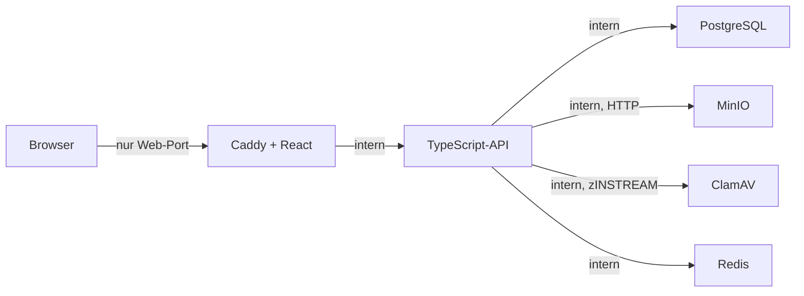
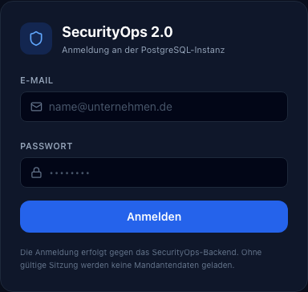
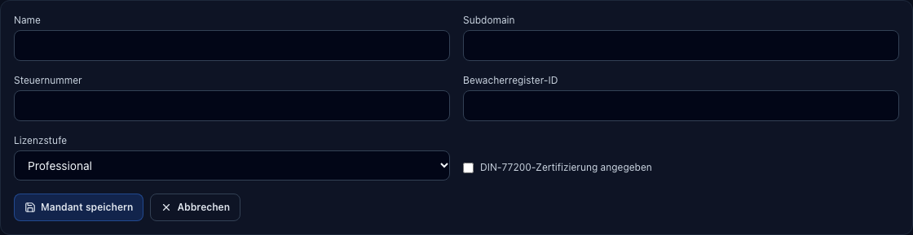

# SecurityOps 2.0 – Linux-Testinstallation (Phase 7)

> **Nur für isolierte Tests. Nicht produktionsbereit.** Diese Installation verwendet
> `NODE_ENV=development`, HTTP für MinIO im internen Docker-Netz und illustrative
> Seed-Daten. Keine echten personenbezogenen oder produktiven Daten verwenden.

Diese eigenständige Testinstallation enthält PostgreSQL, Redis, MinIO, ClamAV,
Backend und Web-Frontend. Nur der Web-Port wird veröffentlicht. Die MinIO-,
ClamAV-, PostgreSQL- und Backend-Ports sind nicht auf dem Host veröffentlicht.
Der Compose-Projektname und alle Passwörter werden bei `install.sh` neu erzeugt.

## Systemaufbau



### Screenshot des Phase-7-Builds



*Aufnahme der unveränderten Login-Oberfläche des gebauten Phase-7-Frontends.
Es wurden keine Benutzer angemeldet, keine Demo-Daten angezeigt und keine echten
personenbezogenen Daten oder Zugangsdaten erfasst.*

Nach dem ausdrücklichen Demo-Seed und der bestätigten Systemadmin-Provisionierung
ist die Phase-7-Mandantenverwaltung in der Navigation verfügbar:



*Echte Aufnahme aus dem isolierten Teststack. Das Formular ist leer; es zeigt keine
Seed-Tenantwerte, Zugangsdaten oder personenbezogenen Angaben.*

## Voraussetzungen

- Linux x86_64/arm64 mit Docker Engine und Compose v2 Plugin
- `openssl`, `curl`, `tar`, `gzip`, mindestens 6 GB freier Speicher
- Für den Image-Build und den ersten Start Internetzugriff zur Docker-Registry und npm
- Mindestens 4 GB RAM (ClamAV-Signaturen und Image-Build benötigen zusätzlichen Speicher)

## Installation

1. Das `.tar.gz` entpacken oder das `.deb` installieren:

   ```sh
   tar -xzf securityops-linux-test-*.tar.gz
   cd securityops-linux-test/app/deploy/linux-test
   ```

   Für Debian/Ubuntu:

   ```sh
   sudo apt install ./securityops-linux-test_*_all.deb
   cd /opt/securityops-linux-test/app/deploy/linux-test
   sudo ./install.sh
   ```

   Das `.deb` installiert nach `/opt`; Konfiguration und Docker-Befehle daher
   mit `sudo` ausführen. `.env` bleibt so root-lesbar und durch Modus `0600`
   geschützt. Beim `.tar.gz` im eigenen beschreibbaren Installationsverzeichnis
   können die folgenden Befehle ohne `sudo` laufen. In allen weiteren Beispielen
   für eine `.deb`-Installation `sudo` vor die Skripte und `docker compose`-Befehle
   setzen.

2. Sichere lokale Konfiguration erzeugen. Das Skript startet keine Dienste:

   ```sh
   ./install.sh
   ```

   `.env` enthält zufällige Datenbank-, JWT- und MinIO-Geheimnisse und wird mit
   Modus `0600` erstellt. Nicht committen oder weitergeben. Der Compose-Projektname
   ist pro Installation zufällig und von vorhandenen `securityops`-Stacks getrennt.

3. Optional `APP_ORIGIN`, `WEB_BIND_ADDRESS` und `WEB_PORT` in `.env` anpassen.
   Standardmäßig bindet die Weboberfläche nur an `127.0.0.1:8080`.

4. Dienste starten und prüfen:

   ```sh
   ./start.sh
   ./healthcheck.sh
   ```

   Bei einer `.deb`-Installation jeweils `sudo ./start.sh` und
   `sudo ./healthcheck.sh` verwenden.

   Der erste Start baut die beiden App-Images lokal und lädt Dienst-Images herunter.
   Die Datenbankmigrationen laufen automatisch. MinIO-Bucket und DMS-Benutzer
   werden initialisiert; Uploads benötigen den lokalen ClamAV-Dienst. In dieser
   Testinstallation sind MinIO-Root und DMS dieselben zufälligen, nur im isolierten
   Compose-Netz verwendeten Zugangsdaten. Das ist ausdrücklich keine
   Least-Privilege-Produktionseinrichtung.

## Browser, DNS, Firewall und TLS

- Lokaler Zugriff: `http://127.0.0.1:8080`.
- Für einen entfernten Browserzugriff nicht einfach den HTTP-Port ins öffentliche
  Internet öffnen. Standardmäßig ist er nur an Loopback gebunden.
- Für einen DNS-Test einen A-/AAAA-Record der Testdomain auf den Server setzen.
  An der Firewall ausschließlich die für den Reverse-Proxy benötigten öffentlichen
  Ports 80/443 freigeben; der App-Port 8080 bleibt an Loopback gebunden.
- Für einen isolierten LAN-Test `WEB_BIND_ADDRESS` auf die interne Server-IP setzen,
  passende `APP_ORIGIN=http://<server-ip>:8080` eintragen und die Firewall auf das
  Testnetz begrenzen. Niemals PostgreSQL 5432, MinIO 9000/9001 oder ClamAV 3310
  freigeben.
- Für DNS/TLS einen vorhandenen TLS-Reverse-Proxy (z. B. Caddy) vor
  `127.0.0.1:8080` konfigurieren; `APP_ORIGIN` muss dann exakt
  `https://<test-domain>` sein. Port 80/443, Redirects und Zertifikate verwaltet
  dieser externe Proxy, nicht diese Testinstallation.
- Die Weboberfläche selbst bietet nur HTTP. Zugangsdaten und Sitzungen sind ohne
  TLS nicht für ein nicht vertrauenswürdiges Netzwerk geschützt. Diese
  Installationsart ist nicht für Produktionsbetrieb gedacht.

## Anmeldung und Phase-7-Tenant-Administration

Es werden **keine Benutzer oder Demo-Daten automatisch angelegt**. Die
Tenant-Administration ist Bestandteil dieses Phase-7-Builds, benötigt aber eine
authentifizierte Benutzer-Sitzung und die passenden serverseitigen Berechtigungen.

Optional Demo-Daten nur in einer frischen, isolierten Testinstallation anlegen:

```sh
./demo-seed.sh
```

Das Skript verlangt eine ausdrückliche Bestätigung und ein eigenes, mindestens
16 Zeichen langes Testpasswort für `a.schmidt@ffm-sec.de`. Dieses Passwort ist
nicht das DB- oder JWT-Secret und wird nicht in `.env` gespeichert. Der bestehende
Fixture-Seed enthält illustrative, personenbezogen wirkende Angaben und ist
ausschließlich Testmaterial. Nutze es nicht für öffentliche Demos oder echte Daten.

Der Seed-Benutzer ist zunächst **kein** Systemadministrator. Wenn die systemweite
Phase-7-Mandantenverwaltung geprüft werden soll, kann dieses Testkonto nach dem
Seed ausdrücklich für diese isolierte Datenbank hochgestuft werden:

```sh
./bootstrap-superadmin.sh
```

Das Skript verlangt eine zweite Bestätigung und ändert ausschließlich das
Demo-Konto `a.schmidt@ffm-sec.de`; melde dich danach mit dem selbst gewählten
Seed-Passwort an. Dieses Bootstrap-Verfahren ist nur für diese Testinstallation
gedacht und keine sichere Produktions-Provisionierung.

## Bedienung

```sh
./healthcheck.sh       # API-Gesundheit und Compose-Status
docker compose --env-file .env -f compose.yml logs -f
./stop.sh              # Dienste stoppen; Volumes bleiben erhalten
./start.sh             # erneut starten
./update.sh            # App-Images neu bauen und aktualisierte Version starten
```

`./update.sh` lädt **keinen neuen Anwendungscode** herunter. Es baut den Quellstand
neu, der bereits in diesem Installationspaket liegt, und startet ihn. Für einen
neuen Phase-7-Teststand zuerst ein neues `.deb` oder `.tar.gz` vom Maintainer
beziehen. Vor einer Aktualisierung Daten sichern; Migrationen beim Start können
die Datenbank ändern. Für das `.deb`:

```sh
sudo apt install ./securityops-linux-test_NEUE-VERSION_all.deb
cd /opt/securityops-linux-test/app/deploy/linux-test
sudo ./update.sh
sudo ./healthcheck.sh
```

Beim `.tar.gz` zunächst in ein **neues** Verzeichnis entpacken. Nach dem Stoppen
des alten Stacks `.env` geschützt in das neue Installationsverzeichnis kopieren,
damit derselbe zufällige Compose-Projektname und die Volumes wiederverwendet
werden. Niemals beide Installationen gleichzeitig mit derselben `.env` starten.
Bei einem Versionswechsel ist eine Rückkehr auf alte Images nach einer
Datenbankmigration nicht garantiert; für Tests ist eine Wiederherstellung aus dem
vorherigen Backup der verlässlichere Rückweg.

## Backup und Wiederherstellung

Der Stack speichert Datenbank und DMS-Dateien getrennt. Ein PostgreSQL-Dump allein
enthält **keine MinIO-Objekte**. Redis enthält nur flüchtige Rate-Limit-Zustände;
ClamAV-Signaturen können nach der Wiederherstellung neu geladen werden. Die
folgenden Schritte sind für einen konsistenten, kurzen Test-Backup ausgelegt:
Web/API zuerst anhalten, dann DB sichern, anschließend alle Dienste stoppen und
das MinIO-Volume kalt kopieren. Sie sind kein Ersatz für ein produktives
Backup-/Recovery-Konzept.

1. Im Installationsverzeichnis eine private Sicherung anlegen. Den Pfad auf
   demselben Docker-Host wählen; das Backup enthält Geheimnisse und muss außerhalb
   des Stacks sicher verwahrt werden:

   ```sh
   umask 077
   BACKUP_DIR="$HOME/securityops-test-backup-$(date -u +%Y%m%dT%H%M%SZ)"
   mkdir -m 700 "$BACKUP_DIR"
   chmod 600 .env
   PROJECT="$(sed -n 's/^COMPOSE_PROJECT_NAME=//p' .env | head -n 1)"
   ```

2. Schreibzugriffe anhalten und PostgreSQL im Custom-Format sichern:

   ```sh
   docker compose --env-file .env -f compose.yml stop web backend
   docker compose --env-file .env -f compose.yml exec -T db \
     sh -c 'pg_dump -U secops_admin -d "$POSTGRES_DB" -Fc' \
     > "$BACKUP_DIR/postgres.dump"
   ```

3. Den Stack anhalten, `.env` sichern und das MinIO-Volume lesend archivieren:

   ```sh
   ./stop.sh
   cp -p .env "$BACKUP_DIR/env"
   chmod 600 "$BACKUP_DIR/env" "$BACKUP_DIR/postgres.dump"
   docker run --rm --network none \
     -v "${PROJECT}_minio_data:/data:ro" \
     -v "$BACKUP_DIR:/backup" \
     busybox:1.36 tar -czf /backup/minio-data.tar.gz -C /data .
   chmod 600 "$BACKUP_DIR/minio-data.tar.gz"
   (cd "$BACKUP_DIR" && sha256sum env postgres.dump minio-data.tar.gz > SHA256SUMS)
   chmod 600 "$BACKUP_DIR/SHA256SUMS"
   ```

   Das Hilfsimage `busybox:1.36` wird bei Bedarf aus der Registry geladen. Die
   enthaltene `.env` schützt Datenbank-/MinIO-Zugang und JWT-Signierschlüssel:
   Backups nicht committen, per E-Mail versenden oder unverschlüsselt außerhalb
   des geschützten Testsystems ablegen.

Für eine Wiederherstellung auf **dieselbe Testinstallation und denselben
Compose-Projektnamen** zuerst die Prüfsummen validieren und das Backup außerhalb
des Webroots bereitstellen. Die Wiederherstellung überschreibt den aktuellen
Datenbank- und MinIO-Teststand:

```sh
cd "$BACKUP_DIR"
sha256sum -c SHA256SUMS
cd /pfad/zur/installation/deploy/linux-test
PROJECT="$(sed -n 's/^COMPOSE_PROJECT_NAME=//p' .env | head -n 1)"
BACKUP_PROJECT="$(sed -n 's/^COMPOSE_PROJECT_NAME=//p' "$BACKUP_DIR/env" | head -n 1)"
test "$PROJECT" = "$BACKUP_PROJECT" || {
  echo "Backup gehört zu einer anderen Compose-Installation." >&2
  exit 1
}
cmp -s .env "$BACKUP_DIR/env" || {
  echo "Die lokale .env weicht vom Backup ab; nicht fortfahren." >&2
  exit 1
}
./stop.sh
docker compose --env-file .env -f compose.yml up -d db
docker compose --env-file .env -f compose.yml exec -T db \
  pg_restore -U secops_admin -d "$(
    sed -n 's/^POSTGRES_DB=//p' .env | head -n 1
  )" --clean --if-exists --no-owner < "$BACKUP_DIR/postgres.dump"
docker compose --env-file .env -f compose.yml stop db
docker run --rm --network none \
  -v "${PROJECT}_minio_data:/data" \
  -v "$BACKUP_DIR:/backup:ro" \
  busybox:1.36 sh -c \
  'find /data -mindepth 1 -maxdepth 1 -exec rm -rf -- {} + &&
   tar -xzf /backup/minio-data.tar.gz -C /data'
docker start "$(
  docker compose --env-file .env -f compose.yml ps -aq db
)" "$(
  docker compose --env-file .env -f compose.yml ps -aq minio
)" "$(
  docker compose --env-file .env -f compose.yml ps -aq redis
)" "$(
  docker compose --env-file .env -f compose.yml ps -aq clamav
)"
docker compose --env-file .env -f compose.yml ps
# Erst fortfahren, wenn PostgreSQL in `ps` als healthy angezeigt wird.
docker start "$(docker compose --env-file .env -f compose.yml ps -aq backend)"
# Erst fortfahren, wenn das Backend healthy ist; dann das Web-Frontend starten.
docker start "$(docker compose --env-file .env -f compose.yml ps -aq web)"
./healthcheck.sh
```

Danach einen Test-Login und, sofern DMS-Daten Teil des Tests sind, einen
bekannten Dateiabruf bzw. Upload samt ClamAV-Scan prüfen. Ein Backup ist erst
brauchbar, wenn die Wiederherstellung in einer isolierten Testinstallation
praktisch erfolgreich war. Die Befehle setzen Docker-Zugriff auf genau diesen
Host und ausreichend freien Speicher voraus. `docker start` setzt voraus, dass die
ursprünglichen Container durch `./stop.sh` nur angehalten und nicht entfernt
wurden. Hier wird bewusst nicht `./start.sh` bzw. `docker compose up` verwendet:
beim Restore sollen die vorhandenen, bereits erfolgreich gelaufenen
Migrations-/DB-Init-One-Shot-Container nicht erneut ausgeführt werden. Vor dem
Löschen/Ersetzen von Testdaten Namen und Compose-Projekt sorgfältig kontrollieren.

## Geheimnisse

- `.env` enthält zufällige DB-, JWT- und MinIO-Schlüssel, gehört dem installierenden
  Benutzer und muss Modus `0600` behalten. Das Installationsskript bewahrt eine
  vorhandene `.env` auf; ein erneuter Aufruf rotiert keine Zugangsdaten.
- Zugangsdaten nicht in Shell-History, Tickets, Screenshots oder Logs kopieren.
  Logs können Anwendungsdaten enthalten und sind ebenfalls als Testdaten zu
  behandeln.
- JWT-, Datenbank- und MinIO-Geheimnisse nicht einzeln „auf Verdacht“ ändern:
  DB- und MinIO-Zugangsdaten müssen mit den tatsächlichen Service-Credentials
  übereinstimmen, und ein JWT-Wechsel beendet bestehende Sitzungen. Für einen
  wegwerfbaren Test ist eine neue, isolierte Installation sicherer als eine
  unvollständige Rotation.

## Logs und Fehlerbehebung

```sh
docker compose --env-file .env -f compose.yml ps
docker compose --env-file .env -f compose.yml logs --tail=200
docker compose --env-file .env -f compose.yml logs -f backend
./healthcheck.sh
```

- **Port bereits belegt:** `WEB_PORT` in `.env` ändern; bei Zugriff über
  Reverse-Proxy muss dieser weiterhin auf den Loopback-Port zeigen. Danach
  `./start.sh` erneut ausführen.
- **Backend bleibt unhealthy:** `ps` und Backend-Logs prüfen; anschließend
  Datenbank-, Redis-, MinIO-Bootstrap- und Migrationsstatus kontrollieren.
  Nicht mit `down --volumes` „reparieren“, wenn Testdaten erhalten bleiben sollen.
- **DMS-Upload schlägt fehl:** sicherstellen, dass `minio-bootstrap` erfolgreich
  beendet wurde und ClamAV gesund/lauffähig ist. `DMS_SCAN_REQUIRED=true` ist
  beabsichtigt; den Scanner nicht zur Umgehung des Fehlers deaktivieren.
- **Browser funktioniert nur lokal:** die Bind-Adresse ist absichtlich
  `127.0.0.1`. Für DNS/TLS einen vorhandenen Reverse-Proxy nutzen und
  `APP_ORIGIN` exakt auf die öffentliche HTTPS-Origin setzen; niemals DB-, API-,
  MinIO- oder ClamAV-Ports öffentlich freigeben.
- **Images lassen sich nicht laden oder bauen:** Registry-/npm-Erreichbarkeit,
  DNS, freien Speicher und RAM prüfen. Der erste Start kann wegen ClamAV-Signaturen
  und Image-Build einige Minuten dauern.
- **Wiederherstellung oder Update schlägt fehl:** Stack anhalten, Logs sichern und
  den letzten verifizierten Test-Backupstand wiederherstellen. Keine Volumes
  manuell löschen, bevor Projektname und Backup überprüft wurden.

## Deinstallation und Testdaten

```sh
./uninstall.sh
```

Entfernt nur Container und Netzwerk; Volumes und `.env` bleiben bestehen. Die
endgültige Löschung erfordert eine zusätzliche, exakte Bestätigung:

```sh
./uninstall.sh --remove-data
```

Das löscht die Volumes nur für den zufälligen Compose-Projektnamen dieser
Installation. Zum Entfernen der Paketdateien auf Debian/Ubuntu:
`sudo apt remove securityops-linux-test`. Das Paket-Deinstallieren löscht die
Testdaten nicht automatisch. Die Dateien unter `/opt/securityops-linux-test`
und deren `.env` anschließend nur nach Bedarf manuell entfernen.

## Paketprüfung und Build-Metadaten

Ein Maintainer kann beide Pakete erzeugen:

```sh
./package.sh /pfad/zu/ausgabe
```

Die Assemblierung enthält den aktuellen Frontend-/Backend-Quellstand einschließlich
Phase 7, aber keine `.env`-Dateien, Node-Abhängigkeiten oder Produktions-Volumes.
Die Pakete sind Installationsmedien für Tests, keine Release- oder
Produktionsfreigabe.
